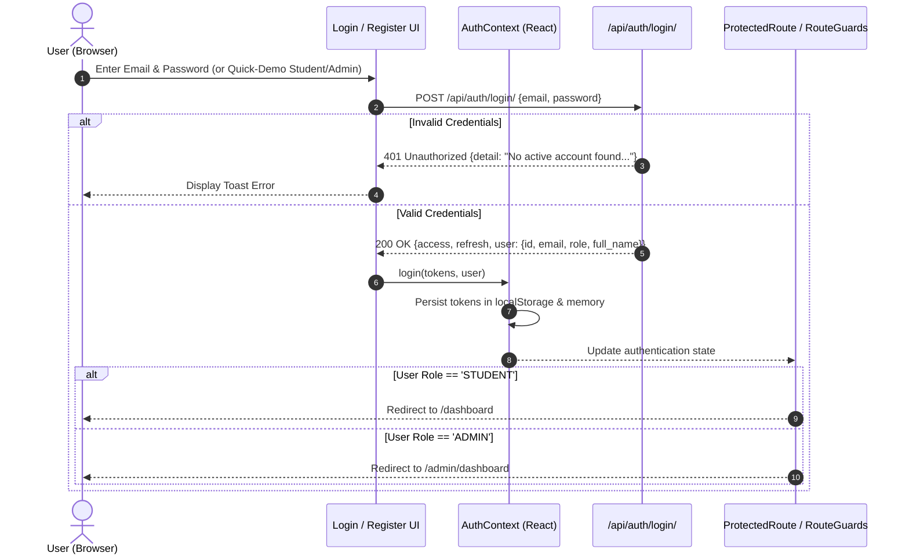
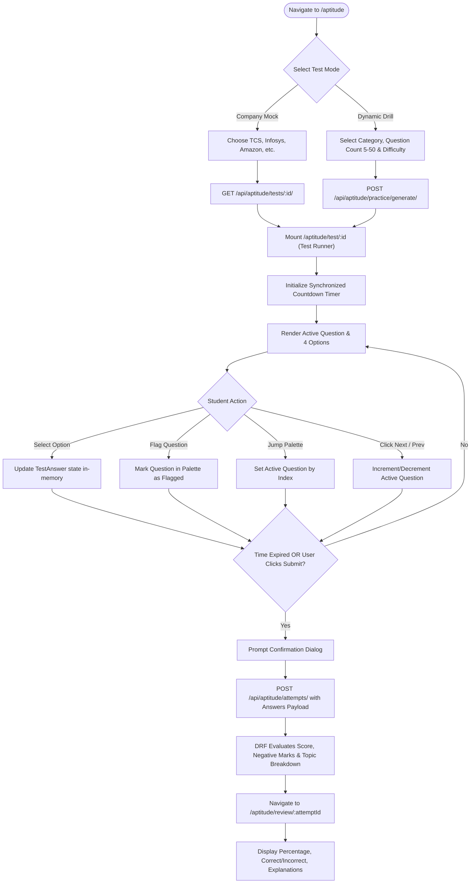
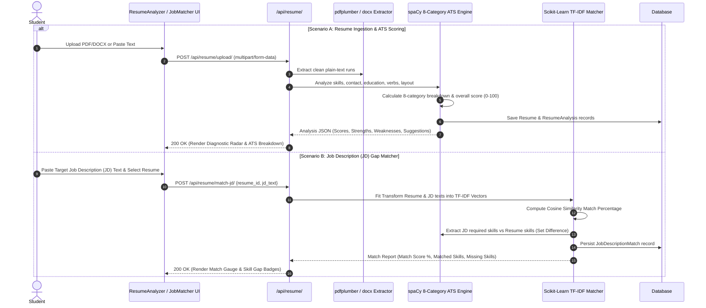
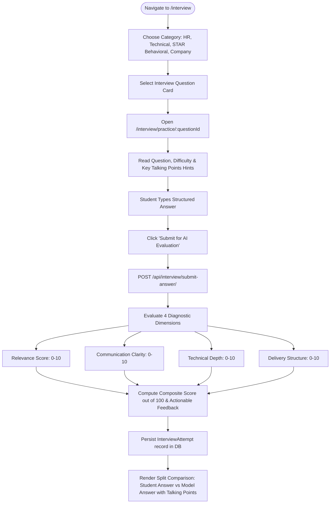
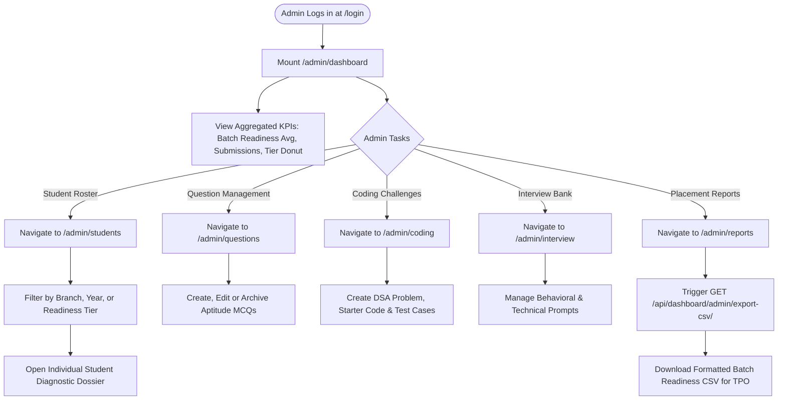
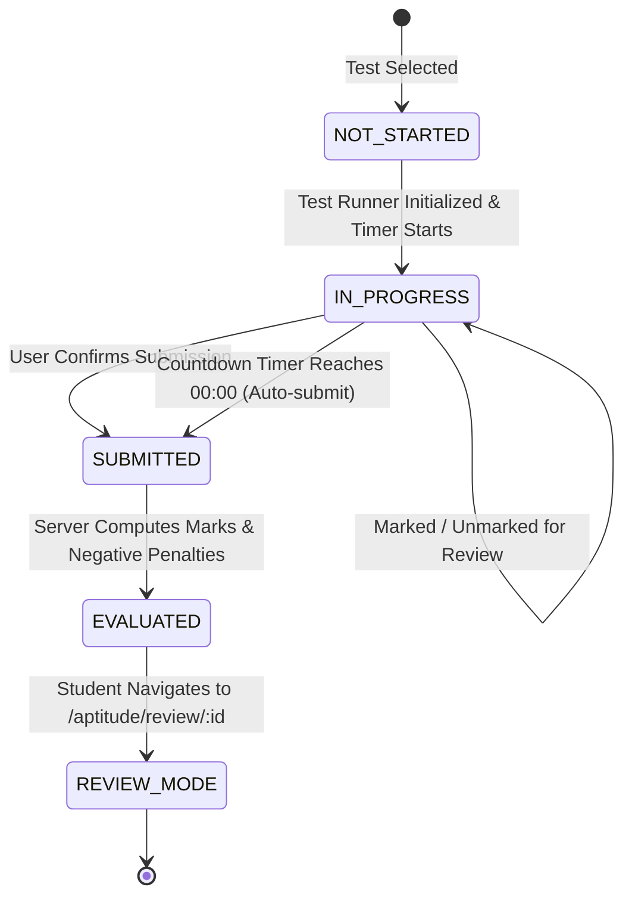
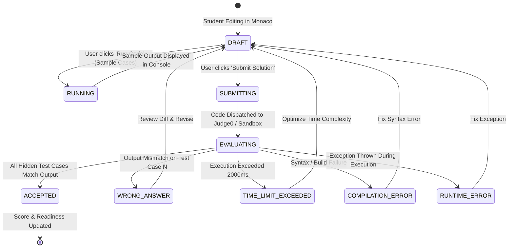

# 🧭 Application Flow & Information Architecture (APP FLOW)
## Placement Preparation Portal (P3)

---

### Document Control
- **Document Version**: 2.0.0
- **Status**: Production Reference
- **System**: End-to-End Navigation, User Journeys, Sitemaps & State Machines
- **Target Audience**: Product Managers, Frontend Engineers, QA Engineers, UX Designers

---

## 1. Information Architecture & Sitemap

```mermaid
graph TD
    Root["/ (Landing / Root Redirect)"] --> AuthCheck{Is Authenticated?}
    
    AuthCheck -->|No| Login["/login"]
    AuthCheck -->|No| Register["/register"]
    
    AuthCheck -->|Yes: Role=STUDENT| StudentPortal[Student Portal]
    AuthCheck -->|Yes: Role=ADMIN| AdminPortal[Admin Operations Center]

    subgraph Student Portal Routes
        StudentPortal --> S_Dash["/dashboard (Readiness Dashboard)"]
        StudentPortal --> S_Apt["/aptitude (Aptitude Lineup & Drills)"]
        S_Apt --> S_AptRun["/aptitude/test/:testId (Live Test Runner)"]
        S_Apt --> S_AptRev["/aptitude/review/:attemptId (Diagnostic Review)"]
        
        StudentPortal --> S_Code["/coding (Coding Problem Catalog)"]
        StudentPortal --> S_DSASheet["/dsa-sheet (49+ Curated DSA Sheet)"]
        S_Code --> S_CodeWork["/coding/:problemId (Monaco Coding Workspace)"]
        S_DSASheet --> S_CodeWork
        
        StudentPortal --> S_Resume["/resume (Resume ATS Analyzer)"]
        StudentPortal --> S_JobMatch["/job-match (Job Description Matcher)"]
        
        StudentPortal --> S_Int["/interview (Interview Preparation Catalog)"]
        S_Int --> S_IntPrac["/interview/practice/:questionId (Mock Interview Arena)"]
        
        StudentPortal --> S_Prog["/progress (Chronological Analytics & Radar)"]
        StudentPortal --> S_Prof["/profile (Student Profile & Portfolio)"]
    end

    subgraph Admin Operations Routes
        AdminPortal --> A_Dash["/admin/dashboard (Batch Analytics & Cohort KPIs)"]
        AdminPortal --> A_Stud["/admin/students (Student Roster & Dossiers)"]
        AdminPortal --> A_Quest["/admin/questions (Aptitude MCQ Management)"]
        AdminPortal --> A_Code["/admin/coding (DSA Problem Management)"]
        AdminPortal --> A_Int["/admin/interview (Interview Question Management)"]
        AdminPortal --> A_Rep["/admin/reports (Batch CSV Export & Insights)"]
        AdminPortal --> A_Prof["/admin/profile (Admin Settings & Profile)"]
    end
```



---

## 2. Authentication, Role Resolution & Session Lifecycle Flow



---

## 3. Student Assessment & Practice Workflows

### 3.1 Aptitude Test & Dynamic Drill Flow


---

### 3.2 Coding Problem & DSA Arena Workflow
```mermaid
flowchart TD
    StartCode([Navigate to /coding or /dsa-sheet]) --> Browse[Browse 49+ Problems with Tag/Difficulty Filter]
    Browse --> SelectProblem[Click Problem Card -> Open /coding/:problemId]
    
    SelectProblem --> FetchSpec[GET /api/coding/problems/:id/]
    FetchSpec --> RenderWorkspace[Mount Split-Screen Monaco Workspace]
    RenderWorkspace --> LoadStarter[Load Language Starter Code & Sample Test Cases]
    
    LoadStarter --> CodeEdit[Student Writes Solution in Monaco Editor]
    CodeEdit --> ActionType{Action Selected}
    
    ActionType -->|Run Code (Sample Cases)| RunAPI[POST /api/coding/run/ {code, language, input}]
    RunAPI --> ExecSample[Judge0 / Subprocess executes against sample I/O]
    ExecSample --> ShowConsole[Render Sample Output vs Expected in Console Tab]
    ShowConsole --> CodeEdit
    
    ActionType -->|Submit Solution| SubAPI[POST /api/coding/problems/:id/submit/]
    SubAPI --> ExecHidden[Judge0 evaluates all hidden test cases]
    ExecHidden --> EvaluateVerdict{Check Results}
    
    EvaluateVerdict -->|All Passed| StatusAccepted[Status: ACCEPTED (Points Awarded)]
    EvaluateVerdict -->|Mismatch| StatusWA[Status: WRONG_ANSWER (Failed Case Diff)]
    EvaluateVerdict -->|Exceeded 2s| StatusTLE[Status: TIME_LIMIT_EXCEEDED]
    EvaluateVerdict -->|Syntax Error| StatusCE[Status: COMPILATION_ERROR (Traceback)]
    
    StatusAccepted --> UpdateStats[Update Coding Score & Readiness Index]
    StatusWA --> ShowConsole
    StatusTLE --> ShowConsole
    StatusCE --> ShowConsole
    UpdateStats --> ShowCelebration[Display Success Modal & Updated Score]
```

---

### 3.3 Resume Upload, ATS Analysis & JD Matching Flow


---

### 3.4 AI Mock Interview Evaluation Flow


---

## 4. Administrator Operations Flow



---

## 5. State Transition Models

### 5.1 Aptitude Test State Machine


### 5.2 Coding Submission State Machine

