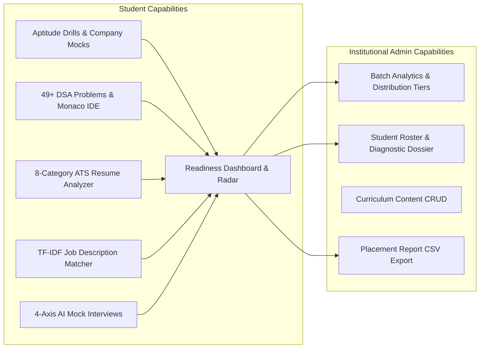

# 📄 Product Requirements Document (PRD)
## Placement Preparation Portal (P3)

---

### Document Control
- **Document Version**: 2.0.0
- **Status**: Approved / In Production
- **Product Name**: Placement Preparation Portal (P3)
- **Target Audience**: University Engineering Students, Placement Cells (TPO), Academic Administrators, Campus Recruiters
- **Tech Ecosystem**: React 18 (Vite), Tailwind CSS, Django REST Framework, PostgreSQL, spaCy NLP, Judge0 Sandbox

---

## 1. Executive Summary & Vision

### 1.1 Product Vision
The **Placement Preparation Portal (P3)** is an institutional-grade, AI-assisted career acceleration and recruitment readiness platform designed for engineering institutions. It unifies the four critical pillars of technical hiring—**Aptitude Testing, Data Structures & Algorithms (DSA) Coding, ATS-compliant Resume Optimization, and AI Mock Interviewing**—into a single, data-driven ecosystem.

### 1.2 Core Problem Statement
Campus placement preparation is traditionally fragmented, unguided, and opaque:
1. **Tool Sprawl**: Students jump between LeetCode for DSA, IndiaBIX for aptitude, external ATS checkers, and unstructured mock interviews without a unified metric of readiness.
2. **Lack of Institutional Visibility**: Training & Placement Officers (TPOs) lack real-time visibility into student strengths, batch readiness distributions, and individual skill deficiencies before company hiring drives arrive.
3. **Delayed Diagnostic Feedback**: Students receive feedback only after failing real placement drives, when course correction is already too late.
4. **Non-Standardized Scoring**: Students cannot quantify if they are genuinely "Placement Ready" across both technical competency and communication skills.

### 1.3 Solution Statement
P3 introduces a centralized **Placement Readiness Engine** featuring a standardized, weighted composite readiness index ($0-100\%$) and structured competency tiers. It delivers targeted company mock tests (TCS, Infosys, Amazon, Google, etc.), an integrated Monaco code execution arena with 49+ curated DSA problems, automated NLP-powered ATS resume parsing with JD gap matching, and a 4-axis AI interview evaluator.

---

## 2. User Personas & Stakeholder Analysis

### 2.1 Persona 1: The Engineering Student ("Aarav")
- **Profile**: 3rd/4th Year B.Tech Computer Science student preparing for upcoming on-campus tier-1 and tier-2 placement drives.
- **Pain Points**:
  - Overwhelmed by disparate syllabus topics (DSA, Aptitude, Core CS subjects).
  - Unsure if their resume passes company ATS filters.
  - Anxious about technical and HR interview rounds; lacks a peer or mentor to practice with on demand.
  - Wants a clear, daily indicator of progress and measurable readiness.
- **Goals**: Achieve a readiness score $>85\%$, solve high-frequency company DSA patterns, identify resume gaps against target Job Descriptions (JDs), and practice structured STAR-method interview answers.

### 2.2 Persona 2: The Training & Placement Officer (TPO) / Admin ("Dr. Sharma")
- **Profile**: Placement Director managing 800+ graduating engineers across Computer Science, Electronics, and Mechanical branches.
- **Pain Points**:
  - Cannot accurately predict which students will clear round-1 online assessments (OAs).
  - Needs actionable diagnostic dossiers to counsel students in the "Developing" or "Beginner" tiers.
  - Manual tracking via spreadsheets is error-prone, outdated, and lacks verifiable submission telemetry.
- **Goals**: Monitor real-time institutional readiness distributions, view filtered student rosters by branch and graduation year, identify bottom-quartile students for remediation, and export comprehensive CSV performance dossiers for corporate recruiters.

---

## 3. Product Scope & Functional Requirements

---

### 3.1 Module 1: Placement Readiness Engine & Analytics Dashboard

#### 3.1.1 Composite Placement Readiness Index
The portal computes an automated, weighted readiness score based on verified database attempts:
$$\text{Readiness Index} = (0.25 \times \text{Aptitude}) + (0.30 \times \text{Coding}) + (0.20 \times \text{Resume}) + (0.25 \times \text{Interview})$$

- **Aptitude Score ($25\%$)**: Historical mean percentage across all completed aptitude assessments and dynamic drills.
- **Coding Score ($30\%$)**: Ratio of unique problems solved with `ACCEPTED` status over total available platform problems ($(\text{Solved} / \text{Total}) \times 100$).
- **Resume Score ($20\%$)**: Composite ATS score ($0-100$) of the student's latest uploaded resume.
- **Interview Score ($25\%$)**: Arithmetic mean of `overall_score` across all attempted mock interview questions.

#### 3.1.2 Dynamic Placement Readiness Tiers
Students are categorized into explicit institutional readiness tiers:
| Score Range | Tier Classification | Color Token | Actionable Guidance |
| :--- | :--- | :--- | :--- |
| **91.0% – 100.0%** | **Excellent** | Emerald (`#10B981`) | Fast-track for Day-1 dream offers ($12+$ LPA); focus on system design and advanced optimization. |
| **76.0% – 90.9%** | **Placement Ready** | Blue (`#3B82F6`) | High probability of clearing tier-1 assessments; maintain daily streak and conduct behavioral mock drills. |
| **61.0% – 75.9%** | **Good** | Indigo (`#6366F1`) | Strong baseline; address specific topic weaknesses in DSA or quantitative aptitude. |
| **41.0% – 60.9%** | **Developing** | Amber (`#F59E0B`) | Requires intervention in coding consistency and resume restructuring. |
| **0.0% – 40.9%** | **Beginner** | Rose (`#EF4444`) | Immediate diagnostic counseling needed; focus on foundational syntax and core quantitative reasoning. |

#### 3.1.3 Chronological Timeline & Competency Radar
- **7-Day Dynamic Progress Timeline**: Chronological trend displaying student performance growth over the past 7 calendar days.
- **Multi-Axis Competency Radar Chart**: Visual breakdown across Quantitative & Logical, Problem Solving & DSA, Resume & ATS Quality, Technical Articulation, and Behavioral & HR.
- **Streak Tracker**: Consecutive day activity tracker that rewards daily practice across any module.
- **Recent Activity Feed**: Real-time click-to-review log with direct deep-links to past test attempts, code submissions, resumes, and interview responses.

---

### 3.2 Module 2: Company-Specific Aptitude & Placement Tests

#### 3.2.1 Company-Specific Mock Tests
Curated mock test patterns replicating actual recruitment exams:
- **Service Tier**: TCS NQT, Infosys InfyTQ, Wipro Elite NTH, Cognizant GenC, Accenture, Capgemini.
- **Product Tier**: Amazon OA, Google Online Challenge, Microsoft, Deloitte.

#### 3.2.2 Dynamic Practice Drill Generator
- On-demand custom drills allowing students to select categories (Quantitative Aptitude, Logical Reasoning, Verbal Ability, Data Interpretation) and flexible question volume (**5, 10, 15, 20, 25, 30, 40, or 50 Questions**).
- Dynamic timer calculation scaled proportionally to question count (e.g., $1.2$ minutes per question).

#### 3.2.3 Interactive Test Runner Interface
- **Question Palette**: Color-coded state management:
  - *Current Active* (Cyan outline / highlight)
  - *Answered / Saved* (Emerald green badge)
  - *Flagged for Review* (Purple flag badge)
  - *Unanswered / Skipped* (Slate muted badge)
- **Countdown Clock**: Real-time JavaScript timer with auto-submit upon expiration.
- **Negative Marking Support**: Configurable negative marking penalties (e.g., $-0.25$ per wrong answer).
- **Post-Submission Diagnostic Review**:
  - Detailed breakdown of correct, incorrect, and unattempted counts.
  - Comprehensive question-by-question solution review displaying student choice vs. correct answer with detailed explanations.

---

### 3.3 Module 3: Coding Practice & DSA Arena

#### 3.3.1 Curated 49+ High-Frequency DSA Sheet
Structured into 8 foundational placement tracks:
1. **Arrays & Two Pointers**: Two Sum, 3Sum, Container With Most Water, Best Time to Buy/Sell Stock, Rotate Array, Kadane's Algorithm.
2. **Sorting Algorithms**: Dutch National Flag (Sort Colors), Merge Sort, Quick Sort, Valid Anagram.
3. **Singly Linked Lists**: Reverse Linked List, Floyd's Cycle Detection, Middle Node, Remove Nth Node From End, Merge Two Sorted Lists.
4. **Doubly Linked Lists**: LRU Cache Design, Browser History, Flatten Multilevel DLL, Reverse DLL, Delete Node.
5. **Stacks & Queues**: Valid Parentheses, Min Stack, Daily Temperatures (Monotonic Stack), Evaluate Reverse Polish Notation, Queue using Stacks.
6. **Trees & Binary Search Trees**: Invert Binary Tree, Validate BST, Maximum Depth, Diameter of Binary Tree, Level Order Traversal (BFS), Lowest Common Ancestor (LCA).
7. **Graphs & Matrices**: Number of Islands (BFS/DFS), Rotting Oranges, Course Schedule (Topological Sort), Clone Graph, Word Ladder, Flood Fill, Surrounded Regions.
8. **Dynamic Programming**: Climbing Stairs, Coin Change, House Robber, Longest Increasing Subsequence (LIS), Trapping Rain Water.

#### 3.3.2 Monaco Code Workspace & Multi-Language Execution
- **Monaco Editor Integration**: Embedded VS Code editing experience with syntax highlighting, line numbers, bracket auto-matching, and dark mode themes (`vs-dark`).
- **Multi-Language Support**: Python 3.8+, JavaScript (Node.js), C++ (GCC), and Java (OpenJDK).
- **Language-Specific Starter Code**: Boilerplate template pre-loaded for each problem.
- **Dual Execution Pipelines**:
  - *Run Code*: Executes code against visible sample test cases without affecting submission score.
  - *Submit Solution*: Executes code against the full suite of hidden test cases, recording execution time (ms), memory footprint (KB), and official submission status (`ACCEPTED`, `WRONG_ANSWER`, `TIME_LIMIT_EXCEEDED`, `COMPILATION_ERROR`, `RUNTIME_ERROR`).

---

### 3.4 Module 4: AI Resume Analyzer & Job Description Matcher

#### 3.4.1 Multi-Format Resume Ingestion & Parsing
- File ingestion supporting **PDF** and **DOCX** formats up to 10MB, plus raw plain-text paste.
- Robust text extraction using `pdfplumber` and `python-docx`.

#### 3.4.2 8-Category ATS Scoring Engine
Evaluates resumes out of 100 points across 8 diagnostic vectors:
1. **Technical Skills (20 pts)**: Presence and diversity of core programming languages, frameworks, databases, and cloud tools.
2. **Work Experience (15 pts)**: Action verbs, company context, and tenure duration.
3. **Projects (15 pts)**: Quantified outcomes, project complexity, and tech stack tags.
4. **Education (10 pts)**: Degree, branch, university, graduation year, and GPA/percentage formats.
5. **Certifications (10 pts)**: Cloud certifications (AWS, GCP, Azure), professional credentials, and honors.
6. **ATS Layout & Structure (10 pts)**: Standard section headers, chronological ordering, and absence of parsing obstacles.
7. **Keyword Density & Action Verbs (10 pts)**: Frequency of high-impact verbs (e.g., *Architected*, *Engineered*, *Optimized*, *Reduced*).
8. **Compliance & Contact Info (10 pts)**: Valid email, phone number, LinkedIn URL, and GitHub repository links.

#### 3.4.3 Job Description (JD) Gap Matcher
- Natural Language Processing (NLP) comparison using **TF-IDF Vectorization** and **Cosine Similarity**.
- Generates an overall match score percentage ($0-100\%$).
- Categorizes extracted keywords into:
  - **Matched Skills**: Overlapping proficiencies present in both resume and target JD.
  - **Missing Skills**: Critical prerequisites present in the JD but absent in the student's resume.
  - **Actionable Recommendations**: Clear suggestions to optimize resume keywords for the specific role.

---

### 3.5 Module 5: AI Mock Interview Preparation

#### 3.5.1 Structured Interview Catalog
- Categorized practice tracks: **HR / Cultural Fit, Core Technical, System Design, Behavioral (STAR methodology), and Company-Specific prompts** (Amazon Leadership Principles, Google, TCS, Infosys).
- Model reference answers with detailed talking points, strategies, and key keywords.

#### 3.5.2 4-Axis AI Evaluation Rubric
Evaluates student text responses out of 100 points via a 4-dimensional diagnostic matrix:
1. **Relevance ($0-10$)**: Direct alignment with the core question and avoidance of filler text.
2. **Communication Clarity & Flow ($0-10$)**: Sentence structure, professional terminology, and narrative coherence.
3. **Technical Correctness & Depth ($0-10$)**: Accurate conceptual terminology, edge case awareness, and depth of technical reasoning.
4. **Delivery Confidence & Structure ($0-10$)**: Application of structured frameworks (e.g., STAR: Situation, Task, Action, Result) and confident professional tone.

#### 3.5.3 Diagnostic Feedback & Model Comparison
- Generates individualized constructive feedback highlighting specific strengths and actionable areas for improvement.
- Side-by-side comparison between student answer and optimal model answer.

---

### 3.6 Module 6: Administrator Operations Center

#### 3.6.1 Batch Readiness Analytics
- Aggregated real-time metrics: Total Registered Students, Active Students (7d), Batch Average Readiness Score, Total Coding Submissions, and Tests Completed.
- Readiness Tier Distribution bar/donut breakdown across the entire cohort.

#### 3.6.2 Student Roster Inspector & Diagnostic Dossier
- Searchable, filterable student registry (Filter by Department/Branch, Graduation Year, and Readiness Tier).
- Detailed student dossier with breakdown across Aptitude, Coding, Resume, and Interview modules.

#### 3.6.3 Curriculum Content Management (CRUD)
- Full administrative management of Aptitude MCQs, Coding Challenges (test cases, starter code, difficulty), and Interview Questions.

#### 3.6.4 Placement Report Generation & CSV Export
- One-click export of batch readiness data into formatted CSV reports containing: Student Name, Email, Branch, Graduation Year, Readiness Score, Tier, Tests Attempted, Aptitude Avg, Problems Solved, ATS Resume Score, and Interview Avg.

---

## 4. Non-Functional Requirements (NFRs)

### 4.1 Performance & Latency
- **Dashboard Load Time**: Initial dashboard API payload (`/api/dashboard/summary/`) must return in $<250\text{ ms}$.
- **Code Execution Latency**: Sandbox compilation and sample execution must complete in $<2.5\text{ s}$ for interpreted languages (Python, JS) and $<4.0\text{ s}$ for compiled languages (C++, Java).
- **Resume Parsing & Scoring**: Complete extraction, spaCy NLP tokenization, and 8-category scoring must complete in $<3.0\text{ s}$ for files up to 10MB.
- **Frontend Bundle Size**: Production Vite build bundle $<600\text{ KB}$ gzipped.

### 4.2 Security & Data Protection
- **Authentication**: Stateless JSON Web Tokens (JWT) with secure access tokens (1-day expiry) and refresh tokens (7-day expiry).
- **Password Security**: Passwords hashed using PBKDF2 with SHA-256 (Django default) or Argon2.
- **Role-Based Access Control (RBAC)**: Strict API-level permission enforcement (`IsAuthenticated`, `IsAdminUser`, `IsStudentUser`) preventing unauthorized horizontal or vertical privilege escalation.
- **Code Execution Sandbox Isolation**: Untrusted student code must be executed inside sandboxed containers with strict memory (128MB), CPU (2 cores), execution time ($5\text{ s}$ wall clock), and network isolation (no outbound internet access).
- **File Upload Sanitization**: Resumes validated for MIME types (`application/pdf`, `application/vnd.openxmlformats-officedocument.wordprocessingml.document`), file size limits ($\le 10\text{MB}$), and sanitized filenames to prevent path traversal attacks.

### 4.3 Reliability & Availability
- **System Availability**: 99.9% uptime during active campus placement seasons.
- **Database Fallback**: Architecture supports seamless local development on SQLite and production deployment on PostgreSQL without code changes.

### 4.4 Accessibility & Responsiveness
- **Responsiveness**: Fully responsive viewport scaling across Mobile ($320\text{px}-767\text{px}$), Tablet ($768\text{px}-1023\text{px}$), and Desktop ($1024\text{px}+$ screens).
- **Accessibility Standards**: WCAG 2.1 Level AA compliance for contrast ratios, ARIA attributes on interactive icons, keyboard navigable forms and code editor focus management.

---

## 5. Release Roadmap & Success Metrics (KPIs)

### 5.1 Success Metrics & KPIs
1. **Readiness Velocity**: $>35\%$ increase in student composite readiness score within 30 days of active platform onboarding.
2. **Placement Conversion Rate**: $>80\%$ of students in the "Placement Ready" ($76-90\%$) and "Excellent" ($91-100\%$) tiers clearing round-1 recruitment tests.
3. **Engagement Retention**: Average weekly active student streak $\ge 4.2$ days.
4. **ATS Pass Rate**: Mean student resume score improvement from baseline ($<55$) to target ($\ge 80$).

### 5.2 Release Milestones
- **Phase 1 (MVP - Completed)**: Core Auth, Aptitude Engine, 49+ DSA Problems with Monaco IDE, NLP Resume ATS Analyzer, AI Mock Interviewer, Placement Readiness Index.
- **Phase 2 (Institutional Rollout - Current)**: Admin Operations Center, Student Roster Dossiers, Batch CSV Export, Company Mock Lineups (TCS, Infosys, Amazon).
- **Phase 3 (Next Release)**: Real-time Audio/Video Mock Interviewing with Speech-to-Text and sentiment analysis; Live Peer Coding Contests with Proctoring.
