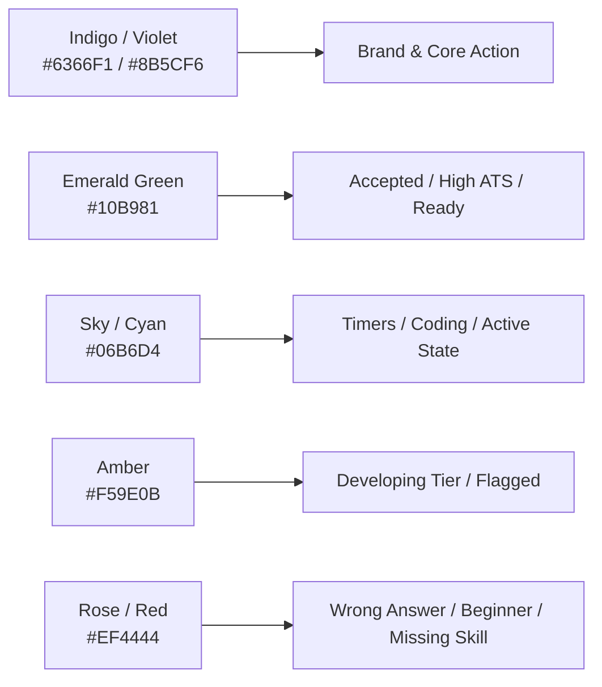

# 🎨 UI / UX Design Brief & Style System
## Placement Preparation Portal (P3)

---

### Document Control
- **Document Version**: 2.0.0
- **Status**: Production Reference
- **System**: UI/UX Design System, Component Guidelines & Visual Specifications
- **Design Philosophy**: High-Performance Dark/Light Engineering Aesthetic, Information-Dense, Glassmorphic Accents, Micro-Animated

---

## 1. Design Philosophy & Brand Identity

### 1.1 Visual Identity & Product Personality
The Placement Preparation Portal is designed for engineering students and institutional placement officers. The design avoids generic "toy" interfaces in favor of a **sleek, developer-first, mission-control aesthetic**:
- **Trust & Precision**: High data density with clean visual hierarchy, sharp contrast, and purposeful typography.
- **Immediate Diagnostic Clarity**: Critical performance indicators (Composite Readiness, Tier Status, Test Timers, ATS Scores) are immediately legible at a glance.
- **Focus & Immersion**: Clean, dark-mode surfaces minimize visual fatigue during long coding practice sessions and timed mock tests.
- **Modern Depth**: Subtle frosted-glass backdrops (`backdrop-blur-md`), refined borders (`border-slate-800`), and soft colored glows highlight active states.

---

## 2. Design Tokens & Color Palette

### 2.1 Color Palette Specifications
The interface utilizes a curated HSL/Hex palette built for both dark-mode intensity and light-mode legibility.



| Semantic Role | Hex Code | Tailwind Token | Usage Context |
| :--- | :--- | :--- | :--- |
| **Primary Brand** | `#6366F1` | `indigo-500` | Primary buttons, brand logos, active tab indicators |
| **Primary Hover** | `#4F46E5` | `indigo-600` | Hover states for primary actions |
| **Secondary Brand** | `#8B5CF6` | `violet-500` | Gradient endpoints, secondary highlights |
| **Success / Accepted**| `#10B981` | `emerald-500` | Solved DSA problems, passing test scores, matched skills |
| **Accent / Focus** | `#06B6D4` | `cyan-500` | Live test timers, current question highlight, coding cursor |
| **Warning / Flagged** | `#F59E0B` | `amber-500` | "Developing" tier badge, flagged aptitude questions |
| **Danger / Error** | `#EF4444` | `rose-500` | Compilation errors, wrong answers, missing resume skills |
| **Surface Dark** | `#0F172A` | `slate-900` | Main application background (Dark Mode) |
| **Card Surface** | `#1E293B` | `slate-800` | Cards, panels, modal containers, question cards |
| **Elevated Surface** | `#334155` | `slate-700` | Dropdowns, hover backgrounds, input fields |
| **Border Dark** | `#334155` | `border-slate-700`| Subtle dividers, card borders |
| **Text Primary** | `#F8FAFC` | `text-slate-50` | Primary headings, prominent scores |
| **Text Secondary** | `#94A3B8` | `text-slate-400` | Secondary labels, timestamps, metadata |
| **Text Muted** | `#64748B` | `text-slate-500` | Placeholders, inactive state indicators |

---

## 3. Typography & Hierarchy

### 3.1 Font Family Stacks
- **Primary Interface Font**: Inter, system-ui, `-apple-system`, `BlinkMacSystemFont`, `Segoe UI`, `Roboto`, `sans-serif`.
- **Monospace / Code Font**: `Fira Code`, `JetBrains Mono`, `Consolas`, `Monaco`, `Courier New`, monospace (configured in Monaco Editor and code snippets).

### 3.2 Typographic Hierarchy
| Level | Font Size | Weight | Line Height | Usage |
| :--- | :--- | :--- | :--- | :--- |
| **Display H1** | $2.25\text{rem}$ ($36\text{px}$) | Bold ($700$) | $1.25$ | Dashboard Welcome, Module Heroes |
| **Section H2** | $1.5\text{rem}$ ($24\text{px}$) | Semibold ($600$) | $1.35$ | Card Group Headings, Page Subheaders |
| **Card Title H3**| $1.125\text{rem}$ ($18\text{px}$)| Semibold ($600$) | $1.4$ | Individual Card Headers, Problem Titles |
| **Body Regular** | $0.875\text{rem}$ ($14\text{px}$)| Normal ($400$) | $1.5$ | Paragraph text, question explanations, descriptions |
| **Body Small** | $0.75\text{rem}$ ($12\text{px}$) | Medium ($500$) | $1.4$ | Tags, badges, timestamps, table metadata |
| **Code Block** | $0.8125\text{rem}$ ($13\text{px}$)| Regular ($400$) | $1.6$ | Monaco editor, sample I/O, console output |

---

## 4. Key Component Specifications & Layouts

### 4.1 Global Layout & Navigation Shell
- **Desktop Sidebar**: Fixed left navigation drawer ($260\text{px}$ width) with dark slate background, featuring institutional branding, student readiness chip, categorized navigation links, active glow indicators, and user profile snippet.
- **Top Bar**: Search bar, current streak flame indicator with counter, quick notification bell, and user avatar dropdown.
- **Mobile Responsive Drawer**: Off-canvas sliding drawer with overlay backdrop blur, triggered via a hamburger button.

### 4.2 Placement Readiness Dial & Tier Component
- **Circular Progress Meter**: Animated SVG ring indicating exact readiness percentage ($0-100\%$).
- **Tier Badge**: Pill container with glowing border corresponding to the student's tier (`Excellent`, `Placement Ready`, `Good`, `Developing`, `Beginner`).
- **Formula Breakdown Tooltip**: Hover card exposing the weighted computation:
  $$(25\% \text{ Apt} + 30\% \text{ Code} + 20\% \text{ Resume} + 25\% \text{ Interview})$$

### 4.3 Interactive Aptitude Test Runner & Question Palette
- **Top Timer Bar**: Sticky countdown clock with urgent pulsing red warning when time remaining $< 2\text{ minutes}$.
- **Question Canvas**: Prominent question text, selectable radio-pill options with subtle hover effects and instant active selection styles.
- **Question Palette Drawer**: Multi-grid numerical matrix representing all test questions with distinct visual statuses:
  - *Current Active*: Sky border with pulse effect.
  - *Answered*: Emerald green filled container with checkmark icon.
  - *Marked for Review*: Purple filled container with flag icon.
  - *Unanswered*: Slate outline with muted text.
- **Action Toolbar**: "Previous", "Next", "Mark for Review & Next", and "Submit Test" with double-confirmation modal.

### 4.4 Monaco Code Workspace (DSA Arena)
```
+-------------------------------------------------------------------------------+
| Problem Title: Container With Most Water     [Medium]  Tags: Two Pointers     |
+------------------------------------+------------------------------------------+
|  Problem Description & Specs       |  Monaco Code Editor                      |
|                                    |  Language: [Python v3.8 v]  Theme: Dark  |
|  - Description                     |  1 def maxArea(height: List[int]) -> int:|
|  - Input / Output format           |  2     left = 0                          |
|  - Constraints                     |  3     right = len(height) - 1           |
|  - Sample I/O 1 & 2                |                                          |
|                                    +------------------------------------------+
|                                    |  Test Case Console & Results             |
|                                    |  [Test Case 1] [Test Case 2] [Custom]    |
|                                    |  Expected: 49  |  Output: 49  (Passed)   |
+------------------------------------+------------------------------------------+
|  [Run Code against Samples]        |  [Submit Solution (All Hidden Cases)]    |
+-------------------------------------------------------------------------------+
```
- **Split-Screen Ergonomics**: Left panel contains Markdown problem description, constraints, and samples; right panel contains full-height Monaco editor and interactive test case console.
- **Console Verdict Banner**: Expandable drawer displaying `ACCEPTED` (green glow), `WRONG_ANSWER` (red alert with diff), or `COMPILATION_ERROR` (formatted traceback in red monospace).

### 4.5 AI Resume ATS Diagnostic Card
- **8-Axis Category Breakdown**: Grid of progress cards for Technical Skills, Work Experience, Projects, Education, Certifications, Layout, Keywords, and Compliance.
- **Strengths & Weaknesses Accordion**: Color-coded bullet points highlighting what the ATS parser parsed cleanly vs. detected formatting flaws.
- **Suggested Additions**: Actionable keyword recommendations to immediately boost the resume score.

### 4.6 Job Description Matcher UI
- **Dual Column Comparator**: Uploaded resume summary on the left, target Job Description input on the right.
- **Match Gauge**: Circular progress score showing overall keyword and semantic match percentage.
- **Skill Pill Tag Clouds**:
  - *Matched Skills*: Green pills with checkmarks (e.g., `Django`, `PostgreSQL`, `Docker`).
  - *Missing Skills*: Red/Amber pills with plus icons (e.g., `Kubernetes`, `GraphQL`, `Redis`).

### 4.7 AI Mock Interview Workspace
- **Side-by-Side Articulation Arena**: Left panel displays interview question, category badge (e.g., *STAR Behavioral*), and key talking points hints.
- **Response Canvas**: Large text area with word counter, readability feedback, and structured STAR prompt guidelines.
- **Post-Submission Evaluation Breakdown**:
  - 4 score bars for Relevance, Communication Flow, Technical Depth, and Delivery Structure.
  - Side-by-side comparison between student response and optimal model answer with highlighted core keywords.

---

## 5. Micro-Interactions & UX States

### 5.1 Interactive States
- **Hover Lift**: Cards elevate slightly (`-translate-y-0.5`) with soft shadow expansion on hover (`hover:shadow-indigo-500/10`).
- **Focus Rings**: Accessible 2px offset cyan focus rings (`focus-visible:ring-2 focus-visible:ring-cyan-400 focus-visible:ring-offset-2`).
- **Button States**: Subtle press feedback (`active:scale-95`) with integrated spinner during asynchronous requests.

### 5.2 Loading & Empty States
- **Skeleton Shimmers**: Content placeholders use animated pulse shimmers matching card geometry instead of intrusive full-page spinners.
- **Meaningful Empty States**: Empty states (e.g., no test attempts yet, no resumes uploaded) feature thematic vector illustrations and primary Call-to-Action (CTA) buttons directing the student to immediate practice.

---

## 6. Accessibility & Responsive Specifications

### 6.1 Responsive Breakpoints
- **Mobile Phone (`< 768px`)**: Single column layout, stacked dashboard cards, full-screen mobile menu drawer, stacked coding workspace.
- **Tablet (`768px - 1023px`)**: Collapsible navigation bar, 2-column grid cards, responsive charts.
- **Desktop (`>= 1024px`)**: Fixed sidebar navigation, multi-column dashboard, side-by-side split coding workspace.

### 6.2 Accessibility Standards (WCAG 2.1 AA)
- Text contrast ratios exceed $4.5:1$ against dark slate backgrounds.
- All non-text interactive elements (buttons, icons, toggles) include descriptive `aria-label` tags.
- Form inputs feature persistent semantic `<label>` elements and visible focus indicators.
- Test runner and coding console support complete keyboard navigation.
